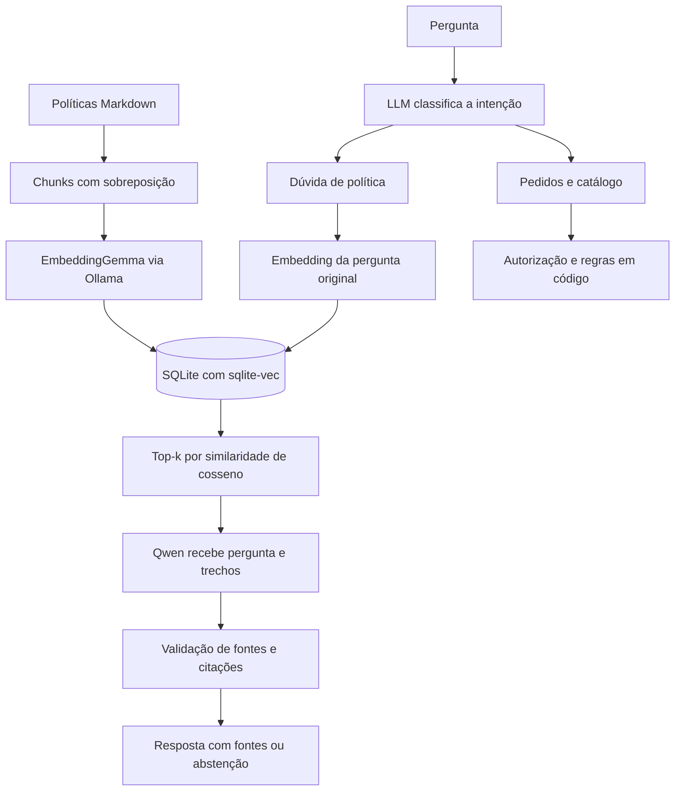

# Pet Aurora — RAG semântico local

Assistente fictício com **RAG generativo usando LangChain**, embeddings locais e banco vetorial persistente. A classificação do assunto continua sendo feita exclusivamente pela LLM. Não há classificação por palavras-chave.

## Onde entra o LangChain

Usamos os pacotes oficiais `langchain-core` e `langchain-ollama`, com versões fixadas em `requirements.txt`. Não é necessário instalar o pacote agregador `langchain`: as integrações modernas são distribuídas em pacotes separados.

- `petz/retrieval.py`: `PolicyRetriever` implementa `BaseRetriever` e retorna objetos `Document` com texto, fonte, identificador e escore. O embedder implementa a interface `Embeddings`; sua chamada HTTP foi mantida para preservar `truncate=false`, os prefixos e a identificação do modelo. O armazenamento continua sendo nosso SQLite/sqlite-vec.
- `petz/assistant.py`: usa `as_langchain_retriever().invoke(...)` para recuperar os documentos da pergunta.
- `petz/rag.py`: compõe `ChatPromptTemplate | ChatOllama.with_structured_output(...) | RunnableLambda`. Essa cadeia LCEL prepara o prompt, gera JSON com o modelo e aplica a validação de citações existente. `generate_answer` executa a cadeia com `.invoke(...)`.

A classificação em `llm.py` usa o cliente HTTP centralizado, com o contrato de tool calling já testado; ela não foi migrada para LangChain. As regras de negócio e a autorização permanecem fora da geração. Não há agente autônomo nem LangGraph neste projeto.

## Configuração e clientes centralizados

Os módulos usam o Ollama para estas tarefas. Os modelos indicados são os padrões, configuráveis por variáveis de ambiente:

| Arquivo | Finalidade | Modelo padrão | Forma de chamada |
| --- | --- | --- | --- |
| **`llm.py`** | Identificar a intenção da pergunta. | `qwen2.5:3b` | HTTP via `urllib`, pelo cliente centralizado. Pode fazer uma segunda tentativa. |
| **`catalog.py`** | Extrair filtros de produtos: nome, espécie, categoria e orçamento. | `qwen2.5:3b` | LangChain com `ChatOllama`, criado pela fábrica centralizada. |
| **`rag.py`** | Gerar respostas com os trechos recuperados das políticas. | `qwen2.5:3b` | LangChain com `ChatOllama`, criado pela fábrica centralizada. |
| **`retrieval.py`** | Gerar embeddings e consultar a identificação do modelo instalado. | `embeddinggemma` | HTTP para `/api/embed` e `/api/tags`, pelo cliente centralizado. |

`petz/config.py` é o único lugar que lê os modelos, endereço e limites do Ollama. `OllamaSettings` reúne a URL, o modelo de conversa, o embedder, os três timeouts e o tempo de permanência em memória. As configurações são lidas ao criar o cliente, sem congelar o ambiente durante o import.

`petz/ollama_client.py` é o único lugar que cria `ChatOllama` e envia requisições HTTP ao serviço. Ele oferece:

- `create_chat_model('catalog')` e `create_chat_model('rag')` para os fluxos LangChain;
- `OllamaClient.chat(...)` para classificação e sua segunda tentativa estruturada;
- `OllamaClient.tags()` e `OllamaClient.embed(...)` para identificação do embedder e geração de vetores com `truncate=false`.

Os perfis de tarefa também ficam nesse módulo: classificação usa até 160 tokens de saída, extração até 240 e geração RAG até 650 com contexto de 4096. Os prompts e a validação dos resultados permanecem nos módulos de cada tarefa. A centralização não junta todas as etapas em uma única chamada nem muda o número de chamadas por conversa. Não há cache global de clientes ou necessidade de reindexar por essa refatoração.

Para atualizar um ambiente já criado:

```powershell
.\.venv\Scripts\python.exe -m pip install -r requirements.txt
.\.venv\Scripts\python.exe -m petz
```

A integração não muda o chunking, os embeddings nem o formato do banco, então não exige reindexação por si só. As dependências LangChain estão instaladas neste workspace. LangSmith pode aparecer como dependência transitiva, mas não configuramos conta, chave ou envio de traces para um serviço externo. Os logs locais continuam sendo a observabilidade padrão.

Os resultados de testes e avaliações ficam exclusivamente em `evals/runs/<execução>/`, com análise em `evals/docs/ANALISE.md`. Os cenários ficam em `evals/datasets/`.

## Executar

Na raiz do projeto, em PowerShell:

```powershell
python -m venv .venv
.\.venv\Scripts\python.exe -m pip install -r requirements.txt
ollama pull qwen2.5:3b
ollama pull embeddinggemma
.\.venv\Scripts\python.exe -m petz.index
.\.venv\Scripts\python.exe -m petz
```

Mantenha o [Ollama](https://ollama.com/download/windows) em execução. O modelo de embeddings é um download adicional de aproximadamente 622 MB e requer Ollama 0.11.10 ou posterior, segundo a [página do modelo](https://ollama.com/library/embeddinggemma). Não é preciso ativar o ambiente virtual: os comandos usam diretamente seu Python. Requer Python 3.10+ com suporte ao carregamento de extensões SQLite.

**Neste workspace, o ambiente, os dois modelos e o índice já foram preparados.** Para conversar agora:

```powershell
.\.venv\Scripts\python.exe -m petz
```

Exemplos de perguntas:

```text
Quanto tempo demora para receber o dinheiro de volta se paguei por Pix?
Como funciona a assinatura recorrente?
Por quantos dias posso buscar meu pacote na loja?
Onde está meu pedido?
1001
```

Digite `sair` para encerrar. A data é obtida do computador, com prioridade para `PETZ_TODAY` se definida. `--date 2026-10-29` reproduz os prazos dos pedidos fictícios. `--customer cliente-2` seleciona a identidade de demonstração; não é autenticação de produção. `--backend ollama` continua aceito, sendo o único backend disponível.

## Fluxo de RAG



O índice contém somente políticas públicas fictícias. Pedidos, identidade do cliente e catálogo não são colocados no banco vetorial. Consultas individuais continuam na ferramenta autorizada; decisões de elegibilidade e filtros de estoque permanecem determinísticos.

Ao pedir um número de pedido, a aplicação registra explicitamente a operação pendente (consulta, devolução ou cancelamento). Uma resposta composta apenas pelos quatro dígitos preenche esse campo e retoma a operação, mesmo se a LLM classificar o número como consulta de status. Isso é continuidade de um fluxo já classificado, não classificação do assunto por palavras-chave. Uma nova pergunta sobre outro assunto encerra a espera pelo número. Rótulos de intenção fora do enum retornados pela ferramenta correta têm uma segunda tentativa JSON limitada; ferramentas desconhecidas e argumentos extras continuam recusados.

## Arquivos principais

| Arquivo | Responsabilidade |
| --- | --- |
| `petz/retrieval.py` | Chunking, embeddings via `/api/embed`, índice `vec0`, manifesto e adapter `BaseRetriever` |
| `petz/index.py` | Comando de indexação explícita e idempotente |
| `petz/rag.py` | Cadeia LangChain de prompt, `ChatOllama`, saída estruturada e validação de citações |
| `petz/llm.py` | Classificação semântica da intenção via tool calling, com segunda tentativa JSON se necessário |
| `petz/config.py` | Leitura única das configurações do Ollama e validação dos timeouts |
| `petz/ollama_client.py` | Fábrica dos clientes LangChain, transporte HTTP e perfis de cada tarefa |
| `petz/assistant.py` | Contexto, ferramentas, políticas, tratamento de erros e traces |
| `petz/catalog.py` | Extração de nome/tema, espécie, categoria, orçamento e consentimento para alternativas |
| `petz/rules.py` | Cálculos de prazo, cancelamento e frete |
| `kit/api_mock.py` | Consulta de pedidos com autorização e erros 403/404/503 |
| `evals/suite.py` | Execução unificada dos testes de engenharia, atendimento e RAG |
| `evals/checks.py` | Verificações determinísticas das respostas de atendimento |

## Embeddings e banco vetorial

Perguntas gerais como “quais produtos vocês têm?” usam a intenção `catalogo`: mostram categorias e uma amostra de até cinco itens reais com estoque. Essa consulta limpa a busca anterior por nome/tema e não chama o extrator de nomes. O usuário pode então informar uma categoria ou espécie. O extrator de filtros recebe apenas a mensagem atual e o indicador de alternativas pendentes; o nome anterior é preservado pela aplicação, sem ser apresentado ao modelo como nome a extrair novamente.

Na busca de produtos, a LLM extrai filtros estruturados via LangChain. Um nome, tema ou SKU específico é preservado entre turnos e filtrado no catálogo por tokens normalizados do nome, descrição e SKU. Se não houver correspondência, a resposta informa a ausência e pergunta se o cliente deseja alternativas. Informar apenas a espécie não remove o nome procurado nem autoriza alternativas. A remoção do filtro depende de aceitação explícita ou de uma nova busca independente, identificadas pela LLM. Nome extraído deve corresponder à mensagem, com normalização de acentos, espaços e pontuação; uma espécie ou categoria genérica não substitui um nome específico. Filtros inválidos ou falha do modelo bloqueiam recomendações até confirmar o nome ou iniciar nova busca. A correspondência é lexical, não tolera todos os erros de digitação e não usa o índice vetorial das políticas. Produtos sem estoque continuam excluídos. A extração é uma chamada adicional ao modelo, sujeita a erro e timeout.

O EmbeddingGemma é separado do modelo de conversa: converte texto em vetores de 768 dimensões na configuração testada. Usa prefixos distintos para consulta e documentos, configuráveis quando se troca de modelo. Chamadas enviam `truncate=false` para não cortar texto silenciosamente. Vetores nulos, não finitos e dimensões incompatíveis são recusados.

Os documentos são divididos em até 110 palavras por trecho, com sobreposição de 25 palavras. Os oito documentos atuais geram 16 chunks. Cada um recebe ID estável, título e caminho de origem. É uma estratégia por palavras, não por tokens; os textos são pequenos e estão abaixo do contexto do embedder testado.

O banco é `data/policies.sqlite3`, com tabelas de chunks, manifesto e uma tabela vetorial `vec0`. A extensão [sqlite-vec](https://alexgarcia.xyz/sqlite-vec/python.html) executa [KNN com distância de cosseno](https://alexgarcia.xyz/sqlite-vec/features/knn.html) dentro do SQLite. Não é um cálculo de vetores implementado manualmente em Python. A busca é exata; não há HNSW/ANN. Para 16 chunks, isso é suficiente e mantém a instalação pequena.

A indexação registra um hash dos textos, versão do chunking, prefixos e digest do modelo. Se nada mudou, o comando não recalcula embeddings. Mudança ou remoção de documentos, modelo ou prefixo exige reindexar. A atualização substitui a coleção toda em uma transação, após gerar os novos vetores; erro remoto nessa etapa preserva a versão anterior. O banco é artefato local, excluído do Git e do ZIP; quem recebe o código deve executar a indexação.

Depois de editar as políticas:

```powershell
.\.venv\Scripts\python.exe -m petz.index
```

Não é preciso reindexar para cada pergunta. Sem índice ou com versão desatualizada, o assistente informa o comando necessário.

## Geração e fontes

Perguntas sobre garantia, garantia estendida, fidelidade e outros temas sem política disponível recebem a resposta de abstenção: “Não sei responder com a base disponível…”. São dúvidas comerciais legítimas, não tentativas de ataque. Perguntas sobre devolução por defeito continuam cobertas pela RN01; o assistente não confunde essa regra com uma garantia não documentada. Após concluir a análise de devolução, a espera por campos é encerrada para não contaminar o assunto seguinte.

A consulta vetorial usa a pergunta original, sem forçar um arquivo pelo nome da intenção. Por padrão, seleciona os quatro trechos mais próximos e aplica similaridade mínima de 0,45 (`1 - distância de cosseno`). Esse valor é uma heurística configurável, não probabilidade de acerto nem limiar universalmente calibrado.

O Qwen recebe pergunta e chunks, com instrução de responder exclusivamente a partir deles. A saída JSON contém `supported`, `answer` e citações com ID do chunk e um trecho literal de evidência. O código valida os IDs e confere que a citação existe no texto recuperado. Os caminhos de fonte são montados pela aplicação, não aceitos do modelo. Sem evidência, o bot se abstém; erro de geração ou citação inválida gera `erro_rag`, sem inventar resposta ou recorrer ao texto completo da política.

**Validar uma citação não prova que toda afirmação está correta.** O modelo ainda pode omitir exceções ou interpretar mal os trechos. A instrução trata documentos como dados não confiáveis, mas não oferece garantia universal contra prompt injection. Casos de saúde ou escalonamento continuam dependentes da classificação pela LLM. Pedidos e cálculos sensíveis mantêm autorização e regras em código.

## Configuração

Variáveis opcionais, via ambiente; o projeto não carrega `.env` automaticamente:

| Variável | Padrão | Uso |
| --- | --- | --- |
| `OLLAMA_URL` | `http://localhost:11434` | Serviço local |
| `OLLAMA_MODEL` | `qwen2.5:3b` | Classificação e geração |
| `OLLAMA_TIMEOUT` | `120` | Timeout por chamada de classificação ou extração de produtos, em segundos |
| `OLLAMA_KEEP_ALIVE` | `5m` | Tempo solicitado ao Ollama para manter modelos carregados |
| `EMBEDDING_MODEL` | `embeddinggemma` | Modelo de embeddings |
| `EMBEDDING_TIMEOUT` | `120` | Timeout de cada chamada do embedder |
| `VECTOR_DB_PATH` | `data/policies.sqlite3` na raiz | Local do banco |
| `RAG_TOP_K` | `4` | Quantidade de chunks candidatos |
| `RAG_MIN_SCORE` | `0.45` | Corte mínimo de similaridade |
| `RAG_TIMEOUT` | `120` | Timeout da geração, em segundos |

`EMBEDDING_QUERY_PREFIX` e `EMBEDDING_DOCUMENT_PREFIX` permitem adaptar os prefixos ao modelo escolhido. Trocar seus valores exige reindexar. Alterar `OLLAMA_MODEL` não exige reindexação; alterar o embedder exige.

Classificação e extração de filtros usam o mesmo timeout padrão de 120 segundos, validado em `petz/config.py`, para acomodar o carregamento inicial do modelo local. Cada uma é uma chamada separada; aumentar o timeout não acelera a inferência nem garante conclusão. O modelo é mantido carregado por cinco minutos após chamadas dessas etapas, quando o Ollama consegue mantê-lo na memória. Se você já definiu `OLLAMA_TIMEOUT=30` no terminal, esse valor continua tendo prioridade; altere-o explicitamente:

```powershell
$env:OLLAMA_TIMEOUT = '120'
.\.venv\Scripts\python.exe -m petz
```

O prompt de `catalog.py` descreve os seis campos do schema, seus valores padrão, limites de preço, preservação de filtros e consentimento, com exemplos completos. null não apaga filtros anteriores; a remoção isolada de orçamento ainda não é representada nesse contrato.

## Testar

A avaliação semântica usa **DeepEval 4.3.2** com Ollama local na etapa de **geração RAG**. Fidelidade e relevância usam `FaithfulnessMetric` e `AnswerRelevancyMetric`; correção factual, completude e utilidade usam `GEval` com etapas próprias. Um `LLMTestCase` separa pergunta, resposta, contexto recuperado e referência. As notas nativas de 0–1 e justificativas são registradas sem renormalização. Erros são registrados por métrica e as demais continuam. Casos parciais preservam notas válidas, sem transformar falhas em zero. Respostas sem saída validada ficam sem julgamento. A verificação literal das citações da resposta continua no pipeline RAG; o DeepEval não fornece o contrato antigo de citações literais do juiz.

O relatório inclui um mapa de todas as métricas com **etapa, método, critério e limitação**, notas por caso e médias com o número de casos aplicáveis. O juiz não altera os resultados determinísticos nem transforma uma falha do assistente em aprovação. Não usamos a marcação `supported` como prova de fidelidade.

As notas semânticas são consultivas, sem limiar de aprovação calibrado. Apenas falhas de execução do juiz alteram o código de saída da suíte; notas baixas ficam explícitas no relatório para revisão. O objetivo é medir dimensões que os checks de texto não cobrem, sem promover uma opinião de modelo a verdade de referência.

Abstenções padronizadas sem afirmações factuais têm fidelidade marcada como não aplicável, sem chamada dessa métrica. Casos sem contexto também não recebem nota de fidelidade. Correção, completude, relevância e utilidade continuam avaliadas, inclusive para identificar recusas indevidas. `threshold=None` mantém todas as notas consultivas. A versão `deepeval-rag-1` não é diretamente comparável ao antigo juiz `rag-semantic-2`.

Por padrão, o juiz usa o modelo já configurado em `OLLAMA_MODEL`, evitando download automático. Essa avaliação **não é independente**: o relatório registra `same_as_generator` e a ausência de calibração humana. Para usar outro modelo local já instalado, configure `JUDGE_MODEL`; `JUDGE_TIMEOUT` tem padrão de 180 segundos por chamada, não por caso completo. As métricas são executadas localmente via `measure`, com telemetria desativada e sem upload ao Confident AI. A calibração humana continua pendente. Veja as documentações de [FaithfulnessMetric](https://deepeval.com/docs/metrics-faithfulness) e [G-Eval](https://deepeval.com/docs/metrics-llm-evals).

```powershell
# Usa o juiz na nova execução completa (padrão).
.\.venv\Scripts\python.exe -m evals.suite

# Só avalia semanticamente as respostas de uma rodada já salva.
# Substitua <identificador> pelo nome real da pasta da rodada.
.\.venv\Scripts\python.exe -m evals.suite --judge-saved evals/runs/<identificador>/results.json

# Opcional: selecione um modelo juiz diferente, que já esteja instalado.
$env:JUDGE_MODEL = 'nome-do-modelo-instalado'

# Desativa apenas o juiz, mantendo todas as verificações anteriores.
.\.venv\Scripts\python.exe -m evals.suite --no-semantic
```

Para rodar tudo com um único comando e salvar os resultados em Markdown:

```powershell
.\.venv\Scripts\python.exe -m evals.suite
```

Mantenha o Ollama aberto e o índice atualizado. O comando valida o kit, roda os testes de engenharia, verifica os modelos e o índice, executa os 30 cenários originais mais seis regressões e avalia onze casos de RAG com recuperação e geração. Os resultados não são corrigidos nem aprovados artificialmente: falhas de classificação, fonte, citação ou conteúdo aparecem no relatório e retornam código 1.

Cada rodada cria apenas três documentos com data/hora e os sufixos **`_CLASSIFICATION.md`**, **`_EXTRACTION.md`** e **`_RAG.md`**. Cada documento mostra primeiro os testes individuais e depois suas métricas finais. Não é gerado um relatório principal. Os resultados de engenharia e atendimento completo continuam disponíveis no `results.json` em `evals/runs/<identificador>/`, junto com cópias dos três documentos. Os checkpoints atualizam apenas os arquivos dessa rodada, preservando execuções anteriores. `Ctrl+C` marca a execução como incompleta. O comando offline gera o mesmo conjunto com as etapas de LLM explicitamente não executadas.

O passo a passo para abrir o terminal, preparar o ambiente, executar e interpretar o resultado está em **`evals/docs/COMO_EXECUTAR.md`**. A primeira rodada completa foi salva: 58/58 testes de engenharia, 24/36 cenários de atendimento e 8/11 cenários RAG passaram nas verificações automáticas. As falhas estão documentadas no relatório e em `evals/docs/ANALISE.md`; esses números não substituem revisão humana nem medem qualquer pergunta possível.

Opções:

```powershell
# Rápido: não chama Ollama e marca as avaliações reais como não executadas.
.\.venv\Scripts\python.exe -m evals.suite --offline --output evals/RELATORIO-OFFLINE.md

# Repete os casos reais para observar variações do modelo.
.\.venv\Scripts\python.exe -m evals.suite --repeats 3

# Escolhe o nome base dos três relatórios.
.\.venv\Scripts\python.exe -m evals.suite --output evals/MEU-RELATORIO.md
```

`evals/datasets/cases.json` contém os 30 cenários de atendimento originais; `evals/datasets/regression_cases.json` acrescenta seis regressões conversacionais. `evals/datasets/rag_cases.json` contém perguntas, passagens de referência, padrões de fatos esperados e abstenções. A suíte mede acerto de fonte, precisão dos chunks retornados, recall de chunks, MRR, nDCG e cobertura das passagens, além de verificações da resposta, citações e latência. As passagens usadas como referência são conferidas nos chunks atuais para detectar datasets desatualizados.

Os checks determinísticos e o juiz semântico são apresentados separadamente. Padrões podem reprovar uma paráfrase correta ou deixar passar uma resposta incompleta; o juiz também pode errar. Revisão humana e calibração permanecem pendentes no relatório. Os casos foram preparados com auxílio de IA, sem revisão independente de especialista.

Para executar somente a validação do kit ou os testes de engenharia:

```powershell
.\.venv\Scripts\python.exe -m kit.validate
.\.venv\Scripts\python.exe -m unittest discover -s tests -v
```

Os testes de engenharia usam o banco SQLite/sqlite-vec real, com embeddings controlados. Verificam persistência, ranking, atualização de políticas, falha de embeddings, dimensões, chunking, citações e integração do dispatcher. Respostas de modelo simuladas nesses testes não medem qualidade semântica.

Os relatórios atuais e suas rodadas em `evals/runs/` pertencem à suíte unificada. Os antigos executores separados e resultados pontuais foram removidos. Nenhuma suíte curada garante generalização; as verificações textuais podem reprovar paráfrases corretas ou aceitar respostas incompletas.

## Observabilidade, custo e limites

### Decisão de modelos e trade-offs

O `qwen2.5:3b` foi escolhido como ponto de partida para uma demonstração local: um único modelo atende classificação, extração estruturada e geração, simplificando instalação e operação. Essa escolha prioriza viabilidade local; não resulta de um benchmark comparativo que prove superioridade sobre outros modelos. As falhas registradas na avaliação mostram que a qualidade ainda precisa melhorar, sobretudo na classificação e nos cenários adversariais. 

O `embeddinggemma` separa a representação semântica da geração de texto e permite indexação e consulta locais. O índice persistente evita recalcular os documentos a cada conversa. Em contrapartida, são dois modelos para carregar e manter, o que pode pressionar a memória. SQLite/sqlite-vec com busca exata foi escolhido pela simplicidade operacional e pelo corpus de apenas 16 chunks; em uma base maior, seria necessário medir a necessidade de outro índice, busca híbrida e reranking. Regras e autorização em código tornam decisões verificáveis, mas exigem manutenção explícita quando as políticas mudam.

### Latência por conversa

A [rodada completa de 31/10/2026](evals/runs/20261031T223524-894000/results.json), com Qwen 2.5 3B e EmbeddingGemma locais, registrou os seguintes tempos totais nos 36 cenários de atendimento:

| Medida | Tempo por cenário/conversa de teste |
| --- | --- |
| Mediana | 8,53 s |
| Média | 15,23 s |
| Percentil 95 (posto mais próximo) | 38,89 s |
| Mínimo–máximo | 4,39–50,83 s |

São 45 turnos distribuídos em 36 cenários; o tempo inclui todos os turnos de cada cenário e as chamadas realizadas pelo assistente, sem o tempo de digitação de uma pessoa. A amostra inclui casos reprovados e não representa apenas respostas corretas. Para uma conversa curta semelhante às do conjunto, a referência inicial é aproximadamente 15 segundos de processamento total, com variação relevante entre fluxos. Esse número não é latência por mensagem nem garantia de produção. Hardware detalhado, concorrência e carregamento frio/quente não foram controlados; a medição deve ser repetida no ambiente de destino. O juiz LLM é uma etapa de avaliação separada e não entra nesses tempos de atendimento.

### Estimativa de custo por conversa

O custo de API de inferência desta implementação local é **R$ 0 por conversa**, pois não há chamadas a um provedor pago. 


Traces em `logs/traces.jsonl` incluem rota, fontes, código da ferramenta, erro de modelo, latência total e metadados de RAG: IDs dos chunks, escores e estágio. Não registram mensagens, embeddings de consulta ou texto das respostas. Resultados de avaliação contêm apenas conversas sintéticas e ficam separados dos logs.

Não há cobrança de API no Ollama local; há consumo de CPU/GPU, RAM e energia. Uma dúvida de política faz uma ou duas chamadas de classificação, um embedding da pergunta e uma geração. A indexação gera embeddings dos documentos uma vez por versão. Carregar os dois modelos em máquina com pouca RAM pode aumentar bastante a latência. Os relatórios reais registram o tempo total por cenário; não são benchmark de produção.

O kit, os prompts de geração de dados e as regras RN01–RN04 estão documentados em `kit/`. Tudo é fictício e foi criado com auxílio do Codex. Não há transações reais, login de produção ou abertura de chamado. Para a regra nova na apresentação, atualizar política e dados, reindexar, adicionar três casos e rodar toda a suíte.

## O que eu faria se tivesse mais tempo

Minha primeira prioridade seria corrigir as falhas de classificação e dos três casos adversariais da rodada registrada, repetindo a suíte para verificar as correções. Depois, evoluiria o projeto nestas frentes:

- **Mais testes e casos de avaliação:** ampliaria o conjunto complementar de regressão, mantendo os 30 casos principais do entregável. Incluiria mais paráfrases, erros de digitação, mensagens ambíguas, conversas longas com mudanças de assunto, limites das regras RN01–RN04 e falhas das ferramentas. Acrescentaria ataques de prompt injection em mensagens e documentos e tentativas de acessar dados de outros clientes. Rodaria os casos várias vezes para medir a consistência das respostas.
- **Comparação de modelos:** um modelo maior ou uma API hospedada seriam alternativas a comparar, considerando qualidade, memória, latência, privacidade e custo. Usaria o mesmo conjunto de avaliação para verificar se a troca melhora classificação, extração e geração antes de adotá-la.
- **Interface de atendimento:** criaria uma interface web de chat com histórico da sessão, fontes consultadas, indicação de processamento e mensagens claras de erro. Faria testes de usabilidade para avaliar se as pessoas conseguem consultar pedidos, entender as regras e pedir ajuda sem depender do terminal.
- **Revisão humana da avaliação:** revisaria as referências com outra pessoa e calibraria um juiz independente do modelo gerador, comparando seus julgamentos com avaliações humanas, principalmente em respostas incompletas, recusas e situações de segurança.
- **Desempenho e custo:** mediria latência e consumo de energia no hardware de destino, separando os fluxos, o carregamento inicial dos modelos e o atendimento simultâneo. Usaria essas medições para avaliar otimizações e estimar o custo operacional por conversa com mais precisão.
- **Qualidade da recuperação:** experimentaria divisão dos documentos por seção, busca híbrida e reranking, adotando as mudanças que melhorassem a recuperação das evidências e a qualidade das respostas nos testes.
- **Integrações e fluxos completos:** implementaria autenticação real, integração com pedidos e encaminhamento ao atendimento humano. Também acrescentaria seleção de itens em pedidos com vários produtos e tratamento de múltiplas intenções na mesma mensagem, preservando autorização e regras de negócio em código.
